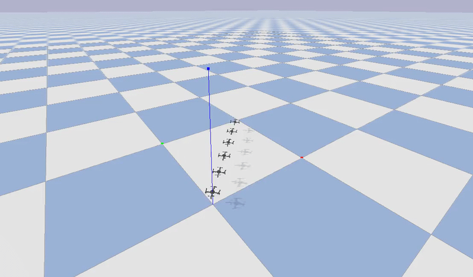

# Multi-Agent Drone Control

This project explores cooperative control for swarms of quadrotors in the
gym-pybullet-drones simulation environment. Using a PyBullet-based
multi-hover task, multiple drones must learn to maintain stable flight and
hover around their target positions while coordinating their continuous
actions. The goal is to train and evaluate a shared multi-agent policy that
scales across a configurable number of drones and produces smooth,
coordinated behavior in simulation.



## Setup

```bash
git clone https://github.com/learnsyslab/gym-pybullet-drones.git
cd gym-pybullet-drones/

conda create -n drones python=3.12
conda activate drones
```

Beyond Python 3.10, `pybullet` has no pre-built wheel.

On Ubuntu, install `gcc` to let `pip3 install` build `pybullet`:

```bash
sudo apt install build-essential
```

On macOS, build and install `pybullet` with:

```bash
CFLAGS="-Dfdopen=fdopen" pip install pybullet --no-cache-dir
```

Install the project in editable mode:

```bash
pip3 install -e .
```

## Training

Train a MAPPO policy for six drones and save the checkpoint:

```bash
python train.py --drones 6 --act-type RPM --save models/rpm_model_6.pt
```

## Inference

Run ten episodes using the saved checkpoint:

```bash
python run.py --checkpoint models/rpm_model_6.pt --episodes 10
```
